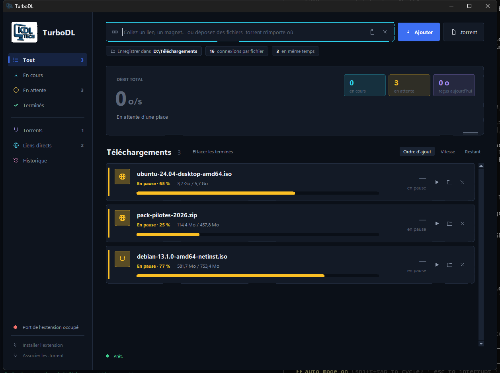
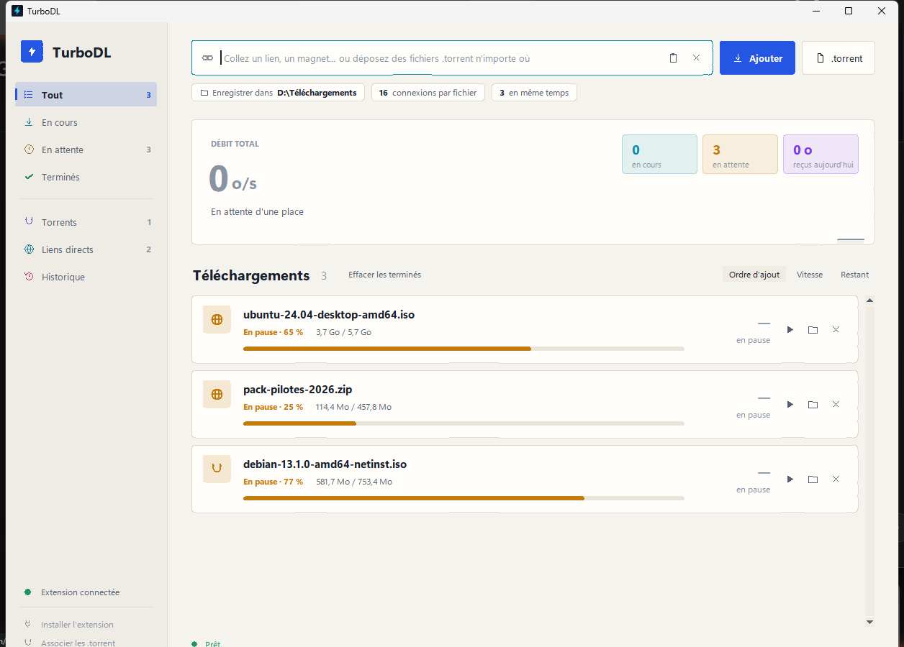

# TurboDL

**FR** — Gestionnaire de téléchargements pour Windows : liens directs multi-connexions et BitTorrent (magnet / .torrent) dans une seule interface, avec reprise automatique et extension navigateur.
**EN** — Windows download manager: multi-connection direct links and BitTorrent (magnet / .torrent) in one window, with automatic resume and a browser extension.

| Sombre / Dark | Clair / Light |
|---|---|
|  |  |

---

## Français

### Fonctions
- **Liens directs** découpés en segments (jusqu'à 32 connexions par fichier), reprise après coupure.
- **BitTorrent** via libtorrent : magnets, fichiers .torrent, DHT, découverte locale, UPnP/NAT-PMP, trackers publics ajoutés automatiquement.
- **File d'attente** : nombre de téléchargements simultanés réglable.
- **Historique** (`%LOCALAPPDATA%\TurboDL\historique.json`) : reprise automatique au redémarrage de ce qui était en cours.
- **Extension navigateur** (Chrome/Edge) pour envoyer un lien à TurboDL d'un clic.
- Thèmes clair et sombre (suit Windows), mise en veille bloquée pendant les téléchargements.

### Nouveautés 1.7.1
- Reprise rapide des torrents : plus de revérification complète à chaque lancement.
- Logo KDL TECH dans l'application, couleurs renforcées, état « Vérification » clair.

### Nouveautés 1.7.0
- Un torrent bloqué à 100 % se termine désormais tout seul.
- Un élément retiré de la liste ne revient plus à chaque lancement (il reste dans l'historique).
- Moteur torrent plus rapide : plus de pairs, connexions plus rapides, files de requêtes plus longues.
- Interface plus colorée : barres de progression en dégradé, catégories et compteurs en couleur.

### Lancer depuis le source
```
pip install libtorrent certifi
python turbodl.py
```

### Compiler l'exe
```
pip install pyinstaller
python -m PyInstaller --noconfirm --onefile --windowed --name TurboDL --icon turbodl.ico ^
  --hidden-import certifi --collect-data certifi --collect-all libtorrent ^
  --add-data "extension;extension" --add-data "turbodl.ico;." turbodl.py
```

---

## English

### Features
- **Direct links** split into segments (up to 32 connections per file), resumable.
- **BitTorrent** via libtorrent: magnets, .torrent files, DHT, local discovery, UPnP/NAT-PMP, public trackers added automatically.
- **Queue** with a configurable number of parallel downloads.
- **History** (`%LOCALAPPDATA%\TurboDL\historique.json`): unfinished downloads resume on restart.
- **Browser extension** (Chrome/Edge) to send a link to TurboDL in one click.
- Light and dark themes (follows Windows); sleep is blocked while downloading.

### What's new in 1.7.1
- Torrent fast resume: no full re-check on every launch.
- KDL TECH logo in the app, stronger colours, clear "checking" state.

### What's new in 1.7.0
- Torrents stuck at 100 % now complete on their own.
- Items removed from the list no longer come back on every launch (they stay in the history).
- Faster torrent engine: more peers, faster connection ramp-up, deeper request queues.
- More colourful UI: gradient progress bars, coloured categories and counters.

### Run from source / build
See the commands in the French section above (`python turbodl.py`, PyInstaller one-file build).

---

Licence : MIT — © KDL TECH
